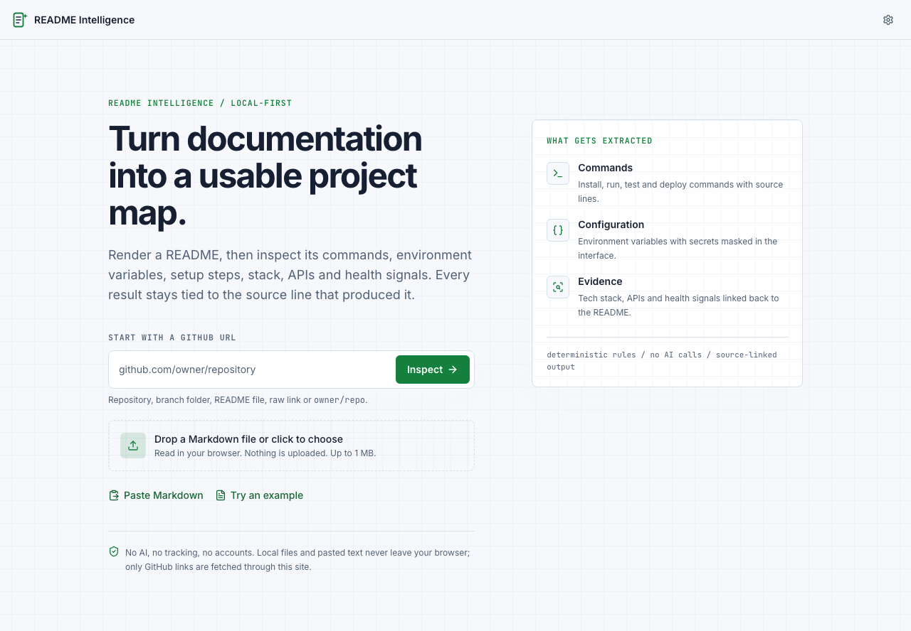

# README Intelligence

README Intelligence helps developers understand an unfamiliar GitHub repository before running anything.

Open a repository and get a source-linked map of its commands, environment variables, setup steps, technology evidence, API endpoints, deployment notes, links, and documentation health. On pull requests, the same deterministic engine detects new contradictions between the README and the repository.

This is a deterministic developer tool. It does not call an LLM, invent missing values, or upload local Markdown.

## The product thesis

The useful question is not only **"what does this README say?"**. It is **"which parts can I trust before I run the project?"**

README Intelligence keeps the README visible, links every extraction to its source line, and checks explicit claims against repository evidence such as manifests, lockfiles, CI, Docker files, source samples, `.env.example`, and `LICENSE`.

It is intentionally narrower than an AI codebase chatbot and documentation publishing platforms. The first product surface is fast, explainable onboarding; the second is preventing README drift in pull requests.

## At a glance

| Area       | Current status                                                              |
| ---------- | --------------------------------------------------------------------------- |
| Input      | GitHub URL, local Markdown, or pasted text                                  |
| Output     | Rendered README plus source-linked project intelligence                     |
| Extraction | Deterministic TypeScript rules with typed, source-linked results            |
| Security   | Sanitized Markdown, masked environment values, local-first file handling    |
| Benchmark  | 59 hand-labeled READMEs; current metrics are published in `docs/RESULTS.md` |
| CI         | GitHub Action comments on PR drift and fails only on new contradictions     |
| Runtime    | Next.js web app with a pure TypeScript core package                         |

The benchmark is useful evidence of engineering quality, not a claim that the extractor is finished. Commands, environment variables, and tech stack are still below their PRD targets. See [Benchmark status](#benchmark-status) before quoting performance numbers.

### Benchmark snapshot

Development-set results on 59 hand-labeled README fixtures:

| Field | F1 | Precision | Recall |
| --- | ---: | ---: | ---: |
| Commands | 76.0% | 69.1% | 84.4% |
| Environment variables | 84.9% | 81.9% | 88.1% |
| Tech stack | 67.8% | 65.0% | 70.8% |
| API endpoints | 100.0% | 100.0% | 100.0% |

These are development-set measurements, not an independent holdout result. The benchmark uses field-specific canonical matching for equivalent command variants, and the complete failure breakdown is in [docs/RESULTS.md](docs/RESULTS.md).

## Live demo

Try the deployed application at [readme-intelligence.vercel.app](https://readme-intelligence.vercel.app/).



The screenshot above was captured from the production deployment.

## Why use it?

README files are useful documentation but poor operational interfaces. A developer usually needs a short list of answers:

- How do I install, run, test, build, or deploy this project?
- Which environment variables are required?
- What runtime, framework, database, and infrastructure does it use?
- Does the README document an API, and where are its endpoints?
- Which claims can be checked against the repository itself?

The viewer makes those answers scannable while preserving the original document for context. GitHub inputs can also run through Reality Check, which compares README claims with manifests, lockfiles, CI, Docker, source files, `.env.example`, and `LICENSE`.

## Who it is for

- Engineers joining an unfamiliar repository and needing a safe first pass.
- Open-source contributors checking setup instructions before filing a change.
- Maintainers who want pull requests to expose stale commands, links, runtimes, or environment variables.
- Teams that prefer deterministic, reviewable checks over an opaque generated summary.

## What makes it different

| Typical tool                          | README Intelligence                                      |
| ------------------------------------- | -------------------------------------------------------- |
| Renders documentation                 | Renders it and extracts an operational project map       |
| Generates an AI summary               | Preserves evidence and does not invent claims            |
| Checks Markdown syntax                | Compares explicit README claims with repository evidence |
| Reports drift after users discover it | Comments on the pull request that introduces it          |

The product is not finished. The benchmark currently shows strong API extraction, but commands, environment variables, and tech-stack extraction remain below their targets. Accuracy numbers are published without rounding them up.

## Features

- GitHub repository, branch folder, README file, raw URL, local file, and pasted Markdown inputs
- GitHub-flavoured Markdown rendering with safe HTML sanitization
- Source-linked intelligence cards for commands, environment variables, setup, stack, APIs, deployment, links, and features
- Secret masking for environment-variable values
- Contents sidebar, scroll spy, source-line jump, command palette, keyboard shortcuts, and JSON export
- Documentation health score with transparent checks and ordered suggestions
- Setup Readiness score based on static repository evidence; it does not install or execute project code
- Reality Check for GitHub repositories, with per-claim evidence and contradiction detection
- GitHub Action for pull-request README drift detection
- Dark, light, and system themes

## Run it locally

Requirements: Node.js 20 or newer and pnpm 12.10.1.

```bash
pnpm install
pnpm dev
```

Open [http://localhost:3000](http://localhost:3000).

### Optional configuration

Copy `apps/web/.env.example` to `apps/web/.env.local` when needed.

| Variable       | Default | Purpose                                                                                |
| -------------- | ------- | -------------------------------------------------------------------------------------- |
| `GITHUB_TOKEN` | unset   | Raises the GitHub API rate limit for public repository reads. Used by the server only. |
| `E2E_PORT`     | `3100`  | Port used by the production server started by the Playwright suite.                    |

## How a developer uses it

1. Enter `owner/repository` or a GitHub URL on the home screen.
2. For local work, drop a `.md`, `.markdown`, `.mdx`, `.mdown`, or `.txt` file. The file is read in the browser.
3. Use **Paste Markdown** when the README is already in your clipboard.
4. Read the rendered document in the center panel and use the intelligence panel to scan the extracted project facts.
5. Select an extracted item to jump to its source line. Treat the line as the final authority when an extraction looks ambiguous.
6. Use **Copy JSON** when another local tool needs the structured result.
7. For a GitHub repository, run **Reality Check** to compare documentation claims with repository evidence.

The extractor is intentionally conservative. A missing item is preferable to an invented command or technology. The current supported language for section names and keywords is English.

### Typical workflow

```text
README input -> rendered document -> extracted cards -> source-line check -> JSON export
                                      \-> Reality Check for GitHub repositories
```

The source-line check is part of the workflow, not an afterthought. Extraction is heuristic, so the viewer always keeps the original README visible beside the structured result.

## Pull-request drift checks

The repository includes a GitHub Action at `.github/workflows/readme-drift.yml`. It checks the target branch and pull-request files with the base version of the checker, posts one readable comment, and fails only when the pull request introduces a new explicit contradiction.

The check is static: it reads text and metadata, but does not install dependencies or execute code from the pull request.

The checker is also available as a composite action for other repositories. Pin it to a release commit when adopting it:

```yaml
- uses: morningstar0521/Readme-Intelligence/.github/actions/readme-drift@main
  with:
    head-path: .
    fail-on: new-contradiction
```

For PR-level comparison, provide separate `base-path` and `head-path` checkouts.

See [docs/ADOPTION.md](docs/ADOPTION.md) for copy-pasteable workflows covering standard pull requests, explicit base/head checkouts, and report-only CI runs.

Run the same check locally:

```bash
pnpm reality ../my-pr --base ../main --format md
pnpm reality . --fail-on new-contradiction
```

## Development commands

Run these from the repository root:

| Command                | Purpose                                                                                                         |
| ---------------------- | --------------------------------------------------------------------------------------------------------------- |
| `pnpm dev`             | Start the Next.js development server.                                                                           |
| `pnpm build`           | Create the production web build.                                                                                |
| `pnpm start`           | Serve the production build.                                                                                     |
| `pnpm check`           | Run lint, typecheck, and core tests.                                                                            |
| `pnpm test:coverage`   | Run core tests with coverage thresholds.                                                                        |
| `pnpm e2e`             | Build and run Playwright smoke tests. Install Chromium once with `pnpm --filter @readme-intel/web e2e:install`. |
| `pnpm cli README.md`   | Print a deterministic README intelligence summary. Add `--format md` or `--format json` for other outputs.     |
| `pnpm cli:build`       | Typecheck the CLI package before packaging it for distribution.                                                  |
| `pnpm eval`            | Evaluate the labeled README benchmark and regenerate `docs/RESULTS.md` and `docs/BENCHMARK.md`.                 |
| `pnpm reality [dir]`   | Run Reality Check against a local checkout without network access.                                              |
| `pnpm fixtures:fetch`  | Fetch the benchmark READMEs listed in `scripts/fixture-repos.json`.                                             |
| `pnpm fixtures:labels` | Create empty label files for new benchmark fixtures.                                                            |

Before opening a pull request, run:

```bash
pnpm --filter @readme-intel/core test
pnpm --filter @readme-intel/core lint
pnpm --filter @readme-intel/core typecheck
pnpm --filter @readme-intel/web lint
pnpm --filter @readme-intel/web typecheck
pnpm e2e
pnpm eval
```

## Architecture

```text
Input
  -> GitHub loader or browser-local file/paste reader
  -> Markdown parser and strict HTML sanitizer
  -> HAST + source-line metadata
  -> deterministic extractors
       commands | env vars | setup | tech stack | APIs | deploy | links | health
  -> typed AnalysisResult
  -> Next.js viewer, evidence cards, search, and JSON export
```

The core package has no React or DOM dependency. The main entry point is:

```ts
import { analyzeReadme } from '@readme-intel/core';

const result = analyzeReadme(markdown, {
  kind: 'local',
  fileName: 'README.md',
});
```

`AnalysisResult` contains the sanitized tree, table of contents, detected sections, structured intelligence, health report, warnings, and search index. The web app renders the tree as React elements; it does not inject README HTML with `innerHTML`.

Key areas:

```text
apps/web        Next.js App Router UI, loaders, viewer, and Playwright tests
packages/core   Pure TypeScript parser, sanitization, extractors, scoring, and schemas
scripts         Evaluation, fixture, Reality Check, and benchmark tooling
docs            extractor notes, security model, benchmark, and design decisions
```

Read the deeper design notes in [docs/ARCHITECTURE.md](docs/ARCHITECTURE.md), [docs/EXTRACTORS.md](docs/EXTRACTORS.md), [docs/REALITY-CHECK.md](docs/REALITY-CHECK.md), and [docs/SECURITY.md](docs/SECURITY.md).

## Documentation map

| Document                                       | Use it when you need to...                                   |
| ---------------------------------------------- | ------------------------------------------------------------ |
| [docs/ARCHITECTURE.md](docs/ARCHITECTURE.md)   | Understand the parser, UI, and data flow.                    |
| [docs/EXTRACTORS.md](docs/EXTRACTORS.md)       | Add or review an extractor rule.                             |
| [docs/SECURITY.md](docs/SECURITY.md)           | Review sanitization, CSP, privacy, and threat boundaries.    |
| [docs/REALITY-CHECK.md](docs/REALITY-CHECK.md) | Compare README claims with repository evidence.              |
| [docs/LABELING.md](docs/LABELING.md)           | Add or modify benchmark labels.                              |
| [docs/BENCHMARK.md](docs/BENCHMARK.md)         | Inspect aggregate metrics and failure examples.              |

## Determinism, privacy, and security

- Local files and pasted text remain in the browser tab.
- GitHub URLs are fetched through the application server because browser CORS rules prevent reliable direct repository access.
- README HTML is parsed and sanitized with an allow-list. The rendered tree is converted to React elements instead of being inserted as raw HTML.
- Extractors use explicit rules, section context, source lines, and typed schemas. There are no AI or external inference calls.
- Environment-variable values are masked in the UI and in exported intelligence where appropriate.
- Reality Check is static evidence comparison. It does not install dependencies, execute scripts, or guarantee that a documented command works.

## Benchmark status

The benchmark contains 59 hand-labeled READMEs. Run `pnpm eval` to regenerate the reports after changing an extractor.

Current results are published in [docs/RESULTS.md](docs/RESULTS.md), with aggregate precision/recall/F1, timing, target status, and failure examples in [docs/BENCHMARK.md](docs/BENCHMARK.md).

The project is still below the PRD targets for commands, environment variables, and tech stack. That is intentional: benchmark numbers are not rounded up or replaced with repository manifest facts. The deterministic design trade-off is documented in [docs/DETERMINISTIC-VS-LLM.md](docs/DETERMINISTIC-VS-LLM.md).

## Extending an extractor

1. Add or update a focused fixture under `packages/core/tests/fixtures` or a unit test under `packages/core/tests/unit`.
2. Label the expected value and source line where the benchmark needs a new case.
3. Add the smallest rule that handles the evidence pattern.
4. Preserve source-line metadata and avoid broad keyword matching without section or syntax context.
5. Run the focused test, the full core suite, lint, typecheck, E2E tests, and `pnpm eval`.
6. Inspect `docs/BENCHMARK.md` for new false positives and false negatives before accepting an accuracy improvement.

The benchmark is README-only. Do not add repository manifest facts to it; those belong in Reality Check.

## Known limitations

- Extraction is heuristic. Commands in images, prose-only setup, unusual tab layouts, and unsupported wording can be missed.
- Section names and matching rules currently target English READMEs.
- The benchmark is a tuned development set with no independent holdout yet; labels are currently recorded with an unknown author in the report.
- Reality Check reads at most 60 repository files, including a 30-file source sample, so it cannot prove every repository fact.
- Relative images in local files and pasted text cannot be loaded without a base URL.
- Mermaid, KaTeX, and footnotes are not rendered yet.
- GitHub's anonymous API limit is 60 requests per hour per server IP. Set `GITHUB_TOKEN` for a deployed instance.

## Deployment

Deployment is intentionally separate from local development. For a Vercel deployment, import the repository, set the project root to `apps/web`, and configure `GITHUB_TOKEN` if the public API rate limit is not sufficient. The Content Security Policy is defined in `apps/web/middleware.ts`.

Deploy after CI is green, then add a short screen recording or hosted demo URL here. Do not add a fake demo link or unsupported accuracy badge.

## Roadmap

1. Improve command, environment-variable, and tech-stack precision against the labeled fixtures.
2. Package and publish the CLI for local and CI use: `npx readme-intel README.md --format json`.
3. Add examples and release automation for the reusable GitHub Action.
4. Add a Chrome side panel for GitHub README pages, reusing `packages/core`.

The Action and CLI come before a browser extension because they create a repeatable maintenance workflow, not only a one-time viewer demo.

## License

MIT
